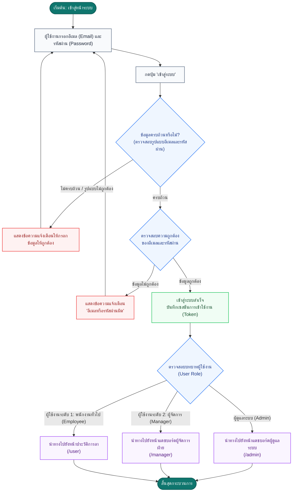

# ผังงานระบบการเข้าสู่ระบบ (Login Flow)

เอกสารนี้แสดงผังงานกระบวนการทำงานของการเข้าสู่ระบบ (Login Flow) ของระบบ **LeaveSystem (ระบบบริหารจัดการการลา)** ครอบคลุมตั้งแต่การกรอกข้อมูล การตรวจสอบความถูกต้อง จนถึงการนำทางผู้ใช้ไปยังหน้าหลักตามบทบาทหน้าที่ (Role-Based Redirection)

---

## 1. แผนภาพผังงาน (Flowchart)

---

## 2. คำอธิบายขั้นตอนการทำงาน (Process Steps)

| ลำดับ | กิจกรรม / ขั้นตอน | รายละเอียด |
| :--- | :--- | :--- |
| **1** | เข้าสู่หน้าระบบ | ผู้ใช้เปิดหน้าเว็บระบบ ระบบจะตรวจสอบหากมีเซสชันเดิมที่ยังไม่หมดอายุจะนำทางไปยังหน้าตามบทบาทอัตโนมัติ หากยังไม่มีจะแสดงหน้าเข้าสู่ระบบ (`/login`) |
| **2** | กรอกข้อมูลการเข้าสู่ระบบ | ผู้ใช้กรอกข้อมูลชื่อบัญชีผู้ใช้ในรูปแบบอีเมล และรหัสผ่านที่กำหนดไว้ |
| **3** | ตรวจสอบความถูกต้องเบื้องต้น (Client Validation) | ระบบตรวจสอบความสมบูรณ์ของฟอร์ม เช่น อีเมลต้องตรงตามรูปแบบ (Email Format) และต้องกรอกรหัสผ่าน |
| **4** | ตรวจสอบข้อมูลบัญชีผู้ใช้ (Authentication) | ระบบทำการตรวจสอบความถูกต้องของอีเมลและรหัสผ่านกับฐานข้อมูล |
| **5** | กรณีการตรวจสอบล้มเหลว | ระบบจะแจ้งเตือนข้อผิดพลาดแก่ผู้ใช้ และคงหน้าจอไว้เพื่อให้กรอกข้อมูลใหม่ |
| **6** | การสร้างเซสชันและตรวจสอบบทบาท | เมื่อผ่านการตรวจสอบ ระบบจะสร้าง Token ประจำเซสชัน และอ่านบทบาท (`role`) ของผู้ใช้งาน |
| **7** | นำทางเข้าสู่หน้าหลักตามบทบาท (Redirection) | • **Admin**: เข้าสู่หน้าภาพรวมแดชบอร์ดระบบ จัดการผู้ใช้และประเภทการลา • **Manager (ระดับ 2)**: เข้าสู่หน้าพิจารณาและอนุมัติคำขอลา • **Employee (ระดับ 1)**: เข้าสู่หน้าสถิติประวัติการลาและยื่นใบลาใหม่ |
