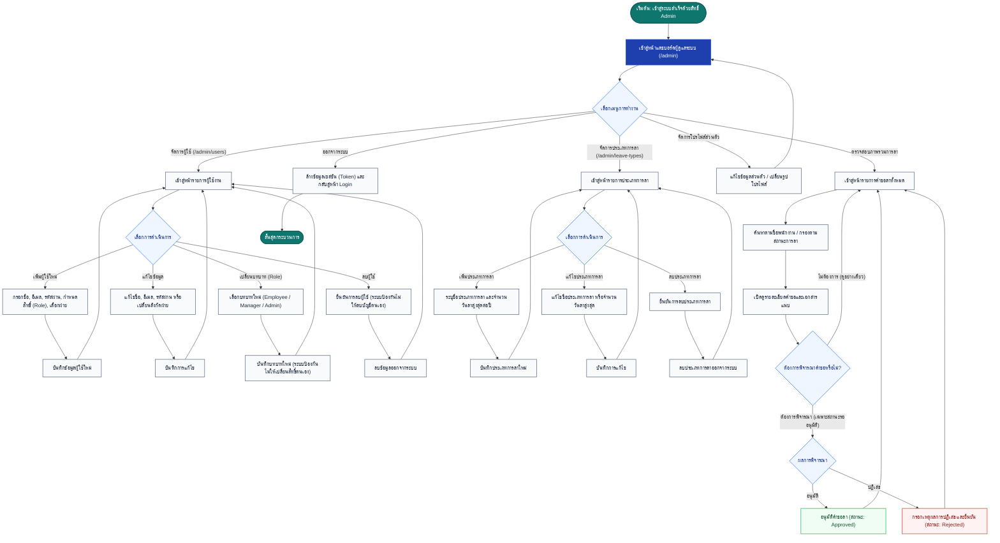

# ผังงานกระบวนการของผู้ดูแลระบบ (Admin Flow)

เอกสารนี้แสดงผังงานกระบวนการทำงานของผู้ดูแลระบบ (Admin) ในระบบ **LeaveSystem (ระบบบริหารจัดการการลา)** ซึ่งมีหน้าที่ควบคุม ดูแลข้อมูลหลักของระบบ (Master Data) บัญชีผู้ใช้งาน สิทธิ์การเข้าถึง และสามารถตรวจสอบภาพรวมการลาทั้งหมดในองค์กรได้

---

## 1. แผนภาพผังงาน (Flowchart)

---

## 2. คำอธิบายหน้าที่และกระบวนการทำงานหลัก (Admin Capabilities)

### 2.1 การจัดการข้อมูลผู้ใช้งาน (User Management)
- **เพิ่มผู้ใช้ใหม่**: กำหนดชื่อ-นามสกุล อีเมล รหัสผ่านเริ่มต้น เลือกระดับบทบาท (`Employee`, `Manager`, `Admin`) และเลือกสังกัดแผนก/ฝ่าย
- **แก้ไขข้อมูล**: สามารถอัปเดตข้อมูลทั่วไปของพนักงาน รวมถึงการรีเซ็ตรหัสผ่านและการย้ายแผนก
- **การปรับเปลี่ยนบทบาท (Role Change)**: สามารถปรับเปลี่ยนระดับสิทธิ์ของพนักงานได้ตามโครงสร้างองค์กร (มีกลไกป้องกันไม่ให้ผู้ดูแลระบบปลดสิทธิ์ตนเองโดยไม่ตั้งใจ)
- **การลบผู้ใช้**: ลบบัญชีผู้ใช้ที่พ้นสภาพ (มีกลไกป้องกันการลบบัญชีตนเอง)

### 2.2 การจัดการประเภทการลา (Leave Types Management)
- **กำหนดประเภทการลา**: เช่น ลาป่วย, ลากิจ, ลาพักร้อน, ลาคลอด
- **กำหนดเพดานวันลาสูงสุด**: กำหนดจำนวนวันลาสูงสุดต่อปี (`max_days`) สำหรับแต่ละประเภทการลา เพื่อใช้เป็นเกณฑ์อ้างอิงในการยื่นคำขอ
- **แก้ไขและปรับปรุง**: ปรับปรุงชื่อประเภทการลาและวันลาสูงสุดให้สอดคล้องกับระเบียบองค์กร

### 2.3 การตรวจสอบแดชบอร์ดภาพรวมการลา (Leave Overview & Approval)
- ผู้ดูแลระบบสามารถมองเห็นใบลาของบุคลากรทุกคนในทุกแผนก
- มีระบบค้นหาและตัวกรองตามสถานะ (รออนุมัติ, อนุมัติแล้ว, ปฏิเสธ)
- ผู้ดูแลระบบมีอำนาจในการพิจารณาอนุมัติหรือปฏิเสธคำขอลาได้โดยตรงในกรณีจำเป็นเร่งด่วน
