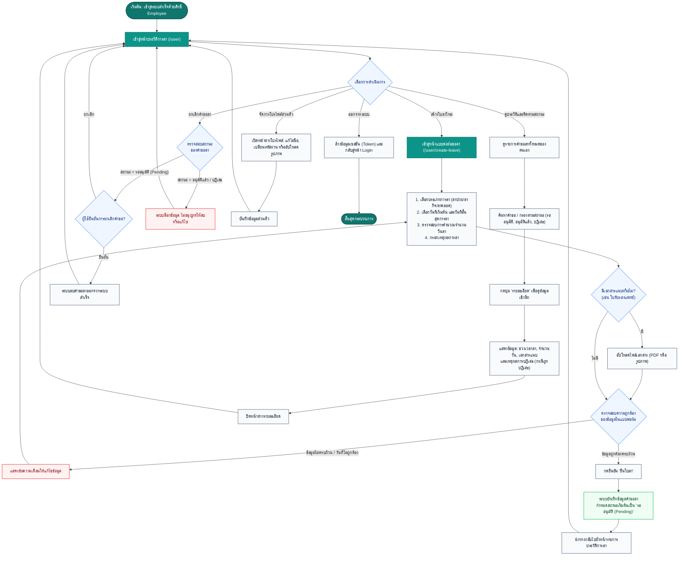

# ผังงานกระบวนการของผู้ใช้งานระดับ 1 (User Level 1 Flow: พนักงานทั่วไป / Employee)

เอกสารนี้แสดงผังงานกระบวนการทำงานของผู้ใช้งานระดับ 1 ซึ่งเป็นพนักงานทั่วไป (`role: employee`) ในระบบ **LeaveSystem (ระบบบริหารจัดการการลา)** ครอบคลุมการตรวจสอบประวัติการลา การสร้างและยื่นคำขอลาใหม่ การติดตามสถานะ และการจัดการคำขอลา

---

## 1. แผนภาพผังงาน (Flowchart)

---

## 2. คำอธิบายขั้นตอนการทำงาน (Process Steps)

### 2.1 การยื่นใบลาใหม่ (Leave Submission Flow)
1. พนักงานเข้าสู่หน้าสร้างใบลาใหม่ (`/user/create-leave`)
2. เลือก **ประเภทการลา** จากรายการที่องค์กรกำหนด (เช่น ลาป่วย, ลากิจ, ลาคลอด)
3. กำหนด **วันที่เริ่มต้น** และ **วันที่สิ้นสุด** โดยระบบจะคำนวณจำนวนวันลาให้อัตโนมัติ
4. ระบุ **เหตุผลการขอลา** เพื่อให้หัวหน้างานใช้ประกอบการพิจารณา
5. กรณีมีเอกสารหลักฐาน เช่น ใบรับรองแพทย์ หรือหนังสือราชการ สามารถแนบไฟล์ในรูปแบบภาพหรือ PDF ได้
6. เมื่อกดยื่นใบลา ข้อมูลจะถูกจัดเก็บเข้าสู่ระบบด้วยสถานะ **"รออนุมัติ (Pending)"** เพื่อรอการพิจารณาจากผู้จัดการฝ่าย

### 2.2 การติดตามสถานะและการจัดการคำขอลา (Tracking & Management)
- **การติดตามสถานะ**: พนักงานสามารถดูสถานะของแต่ละคำขอได้ทันทีผ่านสัญลักษณ์ Badge สถานะ:
  - 🟡 **รออนุมัติ (Pending)**: อยู่ระหว่างรอหัวหน้างานตรวจสอบ
  - 🟢 **อนุมัติแล้ว (Approved)**: ได้รับการอนุมัติเรียบร้อยแล้ว
  - 🔴 **ปฏิเสธ (Rejected)**: ไม่ได้รับการอนุมัติ โดยพนักงานสามารถกดดู "รายละเอียด" เพื่ออ่านเหตุผลที่หัวหน้างานระบุได้
- **เงื่อนไขการยกเลิก/ลบคำขอลา**:
  - สามารถลบคำขอได้ **เฉพาะในกรณีที่สถานะยังเป็น "รออนุมัติ (Pending)" เท่านั้น**
  - หากได้รับการอนุมัติหรือปฏิเสธแล้ว ระบบจะไม่อนุญาตให้แก้ไขหรือลบ เพื่อรักษาความถูกต้องของประวัติการลา
