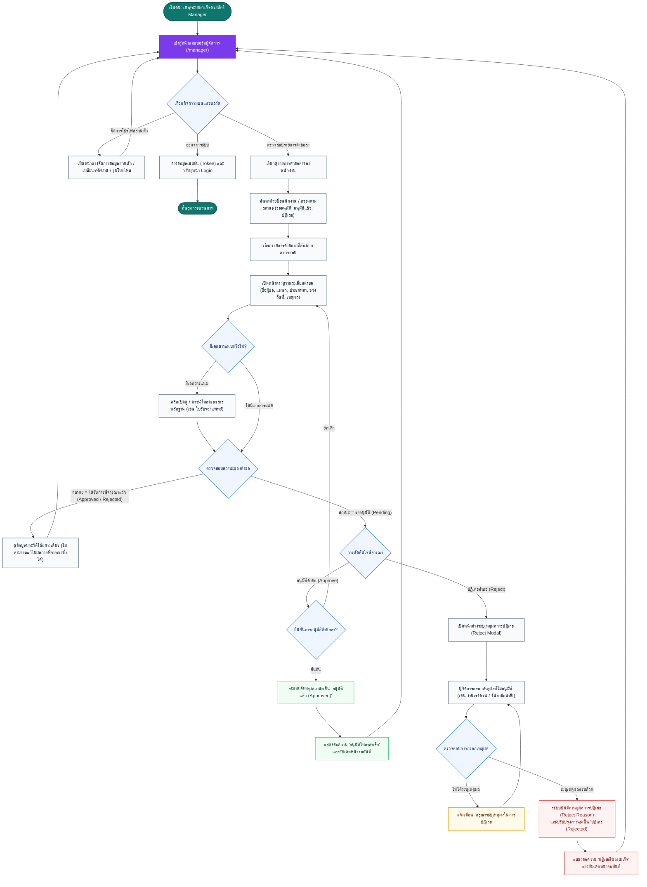

# ผังงานกระบวนการของผู้ใช้งานระดับ 2 (User Level 2 Flow: ผู้จัดการฝ่าย / Manager)

เอกสารนี้แสดงผังงานกระบวนการทำงานของผู้ใช้งานระดับ 2 ซึ่งมีบทบาทเป็นหัวหน้างานหรือผู้จัดการฝ่าย (`role: manager`) ในระบบ **LeaveSystem (ระบบบริหารจัดการการลา)** โดยมีหน้าที่หลักในการตรวจสอบ พิจารณา และอนุมัติหรือปฏิเสธคำขอลาของบุคลากร

---

## 1. แผนภาพผังงาน (Flowchart)

---

## 2. คำอธิบายขั้นตอนการทำงาน (Process Steps)

### 2.1 การตรวจสอบข้อมูลคำขอลา (Review Process)
1. ผู้จัดการเข้าสู่หน้าแดชบอร์ด (`/manager`) จะพบรายการคำขอลาของพนักงานทั้งหมดในระบบ
2. สามารถใช้แถบค้นหาเพื่อพิมพ์ค้นหาตามชื่อพนักงาน, อีเมล, ประเภทการลา หรือเลือกกรองเฉพาะรายการที่อยู่ในสถานะ **"รออนุมัติ (Pending)"** ได้
3. ผู้จัดการสามารถกดปุ่ม **"รายละเอียด"** เพื่อเปิดดูข้อมูลคำขอฉบับเต็ม รวมถึงดาวน์โหลดหรือเปิดดูเอกสารแนบหลักฐาน (เช่น ใบรับรองแพทย์) ก่อนตัดสินใจ

### 2.2 เกณฑ์การตัดสินใจพิจารณาคำขอลา (Approval Workflow)
- **กรณีอนุมัติ (Approved)**:
  - ใช้สำหรับคำขอที่มีเหตุผลสมควร วันลาไม่ขัดต่อระเบียบ และมีเอกสารประกอบถูกต้องครบถ้วน
  - เมื่อผู้จัดการกดยืนยันอนุมัติ สถานะของคำขอจะเปลี่ยนเป็น `approved` ทันที และพนักงานจะเห็นการอัปเดตสถานะในหน้าประวัติของตนเอง
- **กรณีปฏิเสธ (Rejected)**:
  - ใช้ในกรณีที่เอกสารไม่สมบูรณ์ หรือติดภารกิจสำคัญที่ไม่สามารถหยุดงานได้
  - **ข้อกำหนดสำคัญ**: ระบบบังคับให้ผู้จัดการต้องกรอก **"เหตุผลในการปฏิเสธ"** เสมอ เพื่อให้พนักงานผู้ยื่นคำขอรับทราบเหตุผลอย่างโปร่งใส
  - เมื่อบันทึกเรียบร้อย สถานะจะเปลี่ยนเป็น `rejected` พร้อมแนบข้อความเหตุผลให้พนักงานเปิดอ่านได้ในหน้าประวัติการลา
