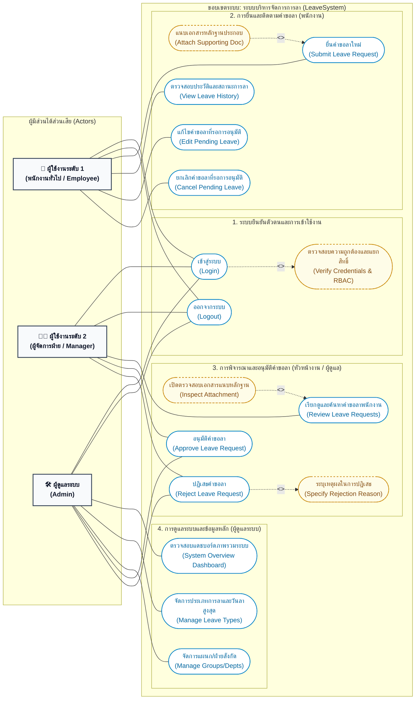

# ผังภาพรวมของระบบทั้งหมด (Use Case Diagram)

เอกสารนี้แสดงภาพรวมการทำงานทั้งหมดของระบบ **LeaveSystem (ระบบบริหารจัดการการลา)** ในรูปแบบ Use Case Diagram ตามมาตรฐานวิศวกรรมซอฟต์แวร์ เพื่อแสดงความสัมพันธ์ระหว่างผู้ใช้งานกลุ่มต่างๆ (Actors) กับฟังก์ชันการทำงานภายในระบบ (Use Cases) พร้อมทั้งระบุความสัมพันธ์ `<<include>>` และ `<<extend>>`

---

## 1. แผนภาพ Use Case Diagram

---

## 2. ตารางสรุปรายละเอียด Use Cases (Use Case Descriptions)

### 2.1 นิยามผู้ใช้งาน (Actors Definition)
| Actor | บทบาทในระบบ | สิทธิ์และหน้าที่หลัก |
| :--- | :--- | :--- |
| **ผู้ใช้งานระดับ 1 (พนักงานทั่วไป / Employee)** | พนักงานผู้ปฏิบัติงาน | ยื่นใบลาใหม่, ติดตามสถานะคำขอลา, ตรวจสอบประวัติการลา, แก้ไขใบลาที่รออนุมัติ, ยกเลิกใบลาที่รออนุมัติ |
| **ผู้ใช้งานระดับ 2 (ผู้จัดการฝ่าย / Manager)** | หัวหน้างาน / ผู้มีอำนาจอนุมัติ | ตรวจสอบรายการคำขอลาของพนักงาน, ตรวจสอบเอกสารแนบ, พิจารณาอนุมัติหรือปฏิเสธพร้อมระบุเหตุผล |
| **ผู้ดูแลระบบ (Admin)** | ผู้ดูแลระบบสารสนเทศ | จัดการประเภทการลาและโควตาวันลา, จัดการแผนก, ดูแลภาพรวมและพิจารณาคำขอลา |

---

### 2.2 รายละเอียด Use Case และความสัมพันธ์
| รหัส | ชื่อ Use Case | ผู้ใช้งาน (Actor) | ความสัมพันธ์ (Relationship) | คำอธิบายสั้น |
| :--- | :--- | :--- | :--- | :--- |
| **UC01** | เข้าสู่ระบบ (Login) | ทุก Actor | `<<include>>` UC02 | เข้าใช้งานระบบด้วยอีเมลและรหัสผ่าน |
| **UC02** | ตรวจสอบความถูกต้องและแยกสิทธิ์ (Verify & RBAC) | ระบบ (System) | Included ใน UC01 | ตรวจสอบข้อมูลในฐานข้อมูลและนำทางไปยังหน้าตามบทบาท |
| **UC03** | ออกจากระบบ (Logout) | ทุก Actor | - | ล้างเซสชันการเข้าใช้งานและกลับสู่หน้า Login |
| **UC04** | ยื่นคำขอลาใหม่ (Submit Leave Request) | Employee | Extended โดย UC05 | กรอกแบบฟอร์มเลือกประเภทลา ระบุช่วงเวลา และเหตุผล |
| **UC05** | แนบเอกสารหลักฐาน (Attach Supporting Doc) | Employee | `<<extend>>` ไปยัง UC04 | อัปโหลดไฟล์ภาพหรือ PDF ประกอบการลา เช่น ใบรับรองแพทย์ |
| **UC06** | ตรวจสอบประวัติและสถานะการลา (View History) | Employee | - | ดูรายการใบลาของตนเอง พร้อมสถานะ Pending, Approved, Rejected |
| **UC07** | แก้ไขคำขอลาที่รออนุมัติ (Edit Pending Leave) | Employee | - | ปรับปรุงข้อมูลคำขอลา วันที่ เหตุผล หรือเอกสารแนบ (เฉพาะสถานะ Pending) |
| **UC08** | ยกเลิกคำขอลาที่รออนุมัติ (Cancel Pending Leave) | Employee | - | ขอยกเลิกคำขอลาที่ยังไม่ผ่านการพิจารณาจากหัวหน้า |
| **UC09** | เรียกดูและค้นหาคำขอลา (Review Leave Requests) | Manager, Admin | Extended โดย UC10 | ดูรายการคำขอลาทั้งหมด กรองตามสถานะ และค้นหาตามชื่อ |
| **UC10** | ตรวจสอบเอกสารแนบ (Inspect Attachment) | Manager, Admin | `<<extend>>` ไปยัง UC09 | เปิดดูหรือดาวน์โหลดเอกสารหลักฐานของพนักงาน |
| **UC11** | อนุมัติคำขอลา (Approve Leave Request) | Manager, Admin | - | ปรับเปลี่ยนสถานะคำขอลาเป็นอนุมัติแล้ว |
| **UC12** | ปฏิเสธคำขอลา (Reject Leave Request) | Manager, Admin | `<<include>>` UC13 | ปรับเปลี่ยนสถานะคำขอลาเป็นปฏิเสธคำขอ |
| **UC13** | ระบุเหตุผลในการปฏิเสธ (Specify Rejection Reason) | Manager, Admin | Included ใน UC12 | บังคับระบุข้อความเหตุผลให้พนักงานทราบเมื่อไม่อนุมัติ |
| **UC14** | ตรวจสอบแดชบอร์ดภาพรวม (System Dashboard) | Admin | - | ดูสถิติและสถานะคำขอลาทั้งหมดของทุกแผนกในองค์กร |
| **UC15** | จัดการประเภทการลา (Manage Leave Types) | Admin | - | เพิ่ม ลบ แก้ไขชื่อประเภทการลา และกำหนดเพดานวันลาสูงสุด |
| **UC16** | จัดการแผนก/ฝ่าย (Manage Groups) | Admin | - | เพิ่ม ลบ แก้ไขข้อมูลโครงสร้างแผนกในองค์กร |
